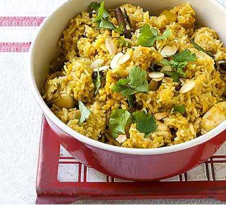

# Chicken biryani

> Household educational study notes for recipe-writing critique. Adapted summary with attribution — always check the original page for the authoritative version.

**Source:** [Good Food team](https://www.bbcgoodfood.com/recipes/chicken-biryani)

*Illustration photo for study — credit linked source / traditional teaching sketch.*

## Key data

| | |
|---|---|
| **Portions** | 4 |
| **Calories** | 660 calories |
| **Prep** | 10 min |
| **Cook** | 30 min |
| **Total** | 40 min |

## Ingredients

- 300g basmati rice
- 25g butter
- 1 large onion finely sliced
- 1 bay leaf
- 3 cardamom pods
- small  cinnamon stick
- 1 tsp turmeric
- 4 skinless chicken breasts cut into large chunks
- 4 tbsp balti curry paste
- 85g raisins
- 850ml chicken stock
- 30g coriander ½ chopped, ½ leaves picked and 2 tbsp toasted flaked almonds, to serve

## Method

1. Soak 300g basmati rice in warm water, then wash in cold until the water runs clear.
2. Heat 25g butter in a saucepan and cook 1 finely sliced large onion with 1 bay leaf, 3 cardamom pods and 1 small cinnamon stick for 10 mins.
3. Sprinkle in 1 tsp turmeric, then add 4 chicken breasts, cut into large chunks, and 4 tbsp curry paste. Cook until aromatic.
4. Stir the rice into the pan with 85g raisins, then pour over 850ml chicken stock.
5. Place a tight-fitting lid on the pan and bring to a hard boil, then lower the heat to a minimum and cook the rice for another 5 mins.
6. Turn off the heat and leave for 10 mins. Stir well, mixing through 15g chopped coriander. To serve, scatter over the leaves of the remaining 15g coriander and 2 tbsp toasted almonds.

---

*Educational / critique use for MealPlan household. Do not republish as your own recipe.*
