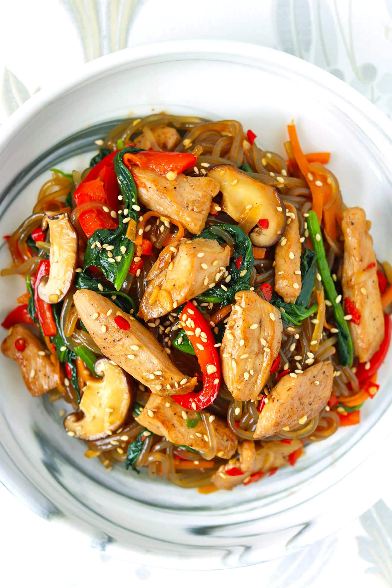

# Chicken Japchae (Korean Glass Noodles Stir-fry)

> Household educational study notes for recipe-writing critique. Adapted summary with attribution — always check the original page for the authoritative version.

**Source:** [Lavina](https://thatspicychick.com/chicken-japchae-korean-glass-noodles-stir-fry/)

*Illustration photo for study — credit linked source / traditional teaching sketch.*

## Key data

| | |
|---|---|
| **Portions** | 2 |
| **Calories** | 628 calories |
| **Prep** | 20 min |
| **Cook** | 15 min |
| **Total** | 35 min |

## Ingredients

- 2.5 TBSP Low Sodium Light Soy Sauce
- 1 TSP granulated White Sugar (or white sugar substitute – note 1)
- ½ TBSP Toasted Sesame Oil
- ⅛ TSP Fine Sea Salt
- ⅛ TSP ground Black Pepper
- 2 cloves Garlic / 15 grams – smashed with the back of a knife, finely sliced (note 2)
- 10 ounces / 280 grams boneless, skinless Chicken Breast (or chicken thighs) – sliced into bite-sized strips
- ¼ TSP Fine Sea Salt
- ⅛ TSP ground Black Pepper
- ½ TBSP Low Sodium Light Soy Sauce
- ½ TSP Toasted Sesame Oil
- 1 TSP Peanut Oil (or any other neutral cooking oil with a high smoke point)
- ⅓ medium / 80 grams Yellow Onion – thinly sliced, then sliced in half
- ½ medium / 100 grams Red Bell Pepper – thinly sliced, then sliced in half
- 1 small / 50 grams Carrot – cut into matchsticks
- 4-5 pieces / 60 grams fresh Shiitake Mushrooms (or other Western or Asian brown mushrooms) – thinly sliced
- 3.5 ounces / 100 grams Chinese Baby Spinach (or Chinese spinach, substitute regular spinach or baby spinach) – chopped into rough chunks
- 1 clove / 5 grams Garlic – smashed, finely sliced (note 2)
- 8-9 pieces / 30 grams Fresh Red Chilies (optional – note 3) – finely chopped
- 5.3 ounces / 150 grams dried Sweet Potato Starch Noodles (‘dangmyeon’ – note 4)
- ½ TBSP Peanut Oil (or other neutral cooking oil)
- ⅛ + ¼ TSP Fine Sea Salt, to taste
- To Serve: ½ TBSP Toasted White Sesame Seeds

## Method

1. In a large mixing bowl, mix together the low sodium light soy sauce, sugar, sesame oil, salt, black pepper and garlic until combined well. Set aside.
2. Clean and slice the chicken into bite-sized strips. Add to a medium bowl, followed by salt, black pepper, low sodium light soy sauce and sesame oil. Mix well to coat and set aside.
3. Chop/slice the yellow onion, red bell pepper, carrot, mushrooms, Chinese baby spinach, garlic and fresh red chilies (if using). Set aside.
4. In a large pot of boiling water (or use the same large wok you’ll use to stir-fry the chicken and veggies), cook the sweet potato glass noodles according the package instructions or until tender, not al-dente (note 5). Drain well. Cut the noodles using kitchen shears if they are the extra long ‘U’ shaped type. Then transfer to the bowl with the seasoning sauce. No need to mix at this point.
5. Heat ½ tablespoon peanut oil in a large nonstick wok (or large skillet) over medium-high heat. Add the onion, mushrooms, carrots and season with ⅛ TSP salt. Stir fry for 2-3 minutes, until starting to soften but the carrots are still tender crisp. Add the garlic and red chilies and stir-fry for 20-30 seconds until fragrant. Add the red bell pepper and stir-fry briefly to combine until barely softened – 30-40 seconds. Add the spinach and ¼ TSP salt.  Stir fry until just wilted – 20 seconds. Transfer to the bowl with the noodles and sauce. Do not mix.
6. Heat the remaining 1 teaspoon of peanut oil in the wok over high heat. Add the marinated chicken and allow to sear for 1 minute. Flip the pieces and sear the other side for another 40 seconds. Stir-fry for 1 minute or so until cooked through. Transfer to the bowl with the sauce, noodles and stir-fried veggies.
7. Add most of the toasted white sesame seeds (reserve some for topping) to the bowl. Toss and mix continuously until everything is combined and evenly coated in the sauce.
8. Transfer to a large serving dish to serve family style or divide evenly onto plates or in bowls. Sprinkle with the remaining sesame seeds. Enjoy warm, at room temperature, or cold from the fridge (note 6).

---

*Educational / critique use for MealPlan household. Do not republish as your own recipe.*
