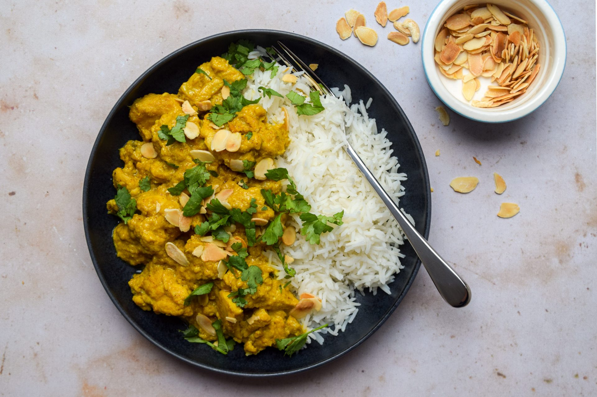

# Chicken Pasanda

> Household educational study notes for recipe-writing critique. Adapted summary with attribution — always check the original page for the authoritative version.

**Source:** [Rachel Phipps](https://www.rachelphipps.com/2020/09/better-than-takeaway-chicken-passanda-curry-recipe.html)

*Illustration photo for study — credit linked source / traditional teaching sketch.*

## Key data

| | |
|---|---|
| **Portions** | 2 |
| **Calories** | Not listed on source |
| **Prep** | 10 min |
| **Cook** | 25 min |
| **Total** | 35 min |

## Ingredients

- 1 1/2 tbsp ghee or light oil
- 1/2 cinnamon stick
- 2 green cardamom pods
- 1 small white onion
- 3 large garlic cloves
- 20g (3/4 oz) fresh ginger
- 1 tsp ground coriander
- 1/2 tsp ground turmeric
- 1/2 tsp mild chilli powder
- 4 skinless boneless chicken thighs
- 150g (5 oz) full fat natural yogurt
- 1/2 tsp sea salt
- 4 tbsp water
- 3 tbsp ground almonds
- small handful freshly chopped coriander, for garnish
- small handful toasted almond flakes, for garnish

## Method

1. Heat a large, non-stick shallow casserole or frying pan over a medium high heat. If you’re serving the passanda with toasted almond flakes, toast these in the dry pan first, and set aside.
2. Heat the ghee or cooking oil until shimmering before toasting the cinnamon stick and the cardamom pods – bashed lightly with a rolling pin to reveal their seeds – for a minute or two until sizzling and fragrant.
3. Meanwhile, peel and roughly chop the onion, garlic and ginger, and blitz to a fine paste in a mini chopper or food processor. Add the mixture to the pan and gently fry for 5 minutes until translucent and starting to brown.
4. Add the ground coriander, tumeric and chilli powder, and fry for a further minute until aromatic.
5. Cube the chicken thighs and stir into the pan until the pieces are well coated in the onion mixture. Stir in the yogurt, salt, water and ground almonds.
6. Raise the heat until the mixture is bubbling before dropping it down to low. Allow the curry to simmer, uncovered, for 15 minutes until the chicken has cooked through and the sauce has thickened.

---

*Educational / critique use for MealPlan household. Do not republish as your own recipe.*
