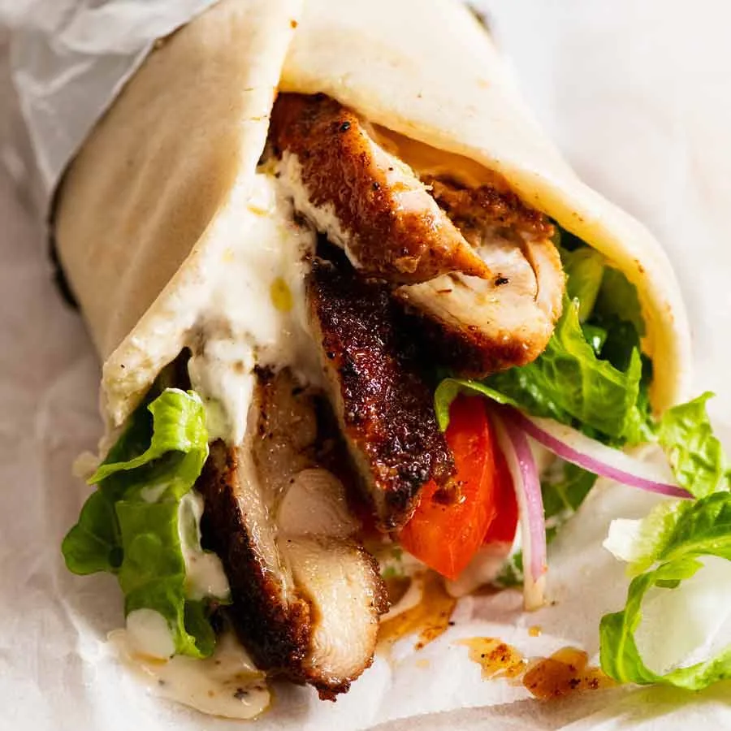

# Chicken Shawarma (Middle Eastern)

> Household educational study notes for recipe-writing critique. Adapted summary with attribution — always check the original page for the authoritative version.

**Source:** [Nagi | RecipeTin Eats](https://www.recipetineats.com/chicken-sharwama-middle-eastern/)

*Illustration photo for study — credit linked source / traditional teaching sketch.*

## Key data

| | |
|---|---|
| **Portions** | 4 |
| **Calories** | 275 kcal |
| **Prep** | 10 min |
| **Cook** | 10 min |
| **Total** | 20 min |

## Ingredients

- 1 kg / 2 lb  chicken thigh fillets (, skinless and boneless (Note 3))
- 1  large garlic clove (, minced (or 2 small cloves))
- 1 tbsp ground coriander
- 1 tbsp ground cumin
- 1 tbsp ground cardamon
- 1 tsp ground cayenne pepper ((reduce to 1/2 tsp to make it not spicy))
- 2 tsp smoked paprika
- 2 tsp salt
- Black pepper
- 2 tbsp lemon juice
- 3 tbsp olive oil
- 1 batch Lemon yogurt sauce
- 4 - 5 flatbreads ((Lebanese or pita bread orhomemade soft flatbreads))
- Sliced lettuce ((cos or iceberg))
- Tomato slices
- Red onion (, finely sliced)
- Cheese (, shredded (optional))
- Hot sauce of choice ((optional))

## Method

1. Marinade chicken - Combine the marinade ingredients in a large ziplock bag. Add the chicken, seal, the massage from the outside with your hands to make sure each piece is coated. Marinate 24 hours (minimum 3 hours).
2. Yogurt Sauce - Combine the Yogurt Sauce ingredients in a bowl and mix. Cover and put in the fridge until required (it will last for 3 days in the fridge).
3. Preheat stove or BBQ - Heat a large non-stick skillet with 1 tablespoon over medium high heat, or lightly brush a BBQ hotplate/grills with oil and heat to medium high. (See notes for baking)
4. Cook chicken - Place chicken in the skillet or on the grill and cook the first side for 4 to 5 minutes until nicely charred. Turn and cook the other side for 3 to 4 minutes (the 2nd side takes less time).
5. Rest - Remove chicken from the grill and cover loosely with foil. Set aside to rest for 5 minutes.
6. Slice chicken and pile onto platter alongside flatbreads, Salad and the Yoghurt Sauce (or dairy free Tahini sauce from this recipe).
7. To make a wrap, get a piece of flatbread and smear with Yoghurt Sauce. Top with a bit of lettuce and tomato and Chicken Shawarma. Roll up and enjoy!

---

*Educational / critique use for MealPlan household. Do not republish as your own recipe.*
