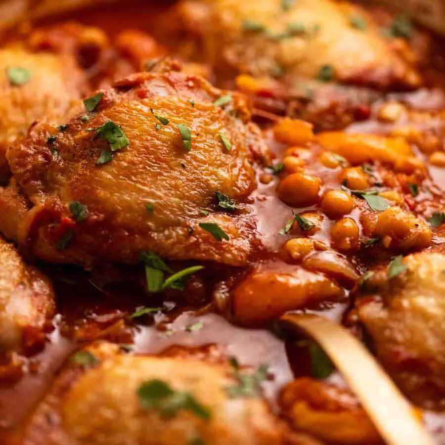

# Chicken Tagine

> Household educational study notes for recipe-writing critique. Adapted summary with attribution — always check the original page for the authoritative version.

**Source:** [Original recipe](https://www.recipetineats.com/chicken-tagine/)

**Household changes:** Added couscous as the carb. Added 2 tins of tomatoes for flavour.

*Illustration photo for study — credit linked source / traditional teaching sketch.*

## Key data

| | |
|---|---|
| **Portions** | 6 |
| **Calories** | 604 kcal |
| **Prep** | 15 min |
| **Cook** | 40 min |

## Ingredients

- 1 cup dried apricot, halved ((Note 1))
- 6 x 220g / 7 oz chicken thighs (, bone-in skin-on (Note 2))
- 3/4 tsp salt ((cooking/kosher salt))
- 2 tbsp olive oil
- 1  onion ((brown/yellow), cut into 0.3 cm/ 1/8" slices)
- 2  garlic cloves (, finely minced)
- 1  cinnamon stick ((sub 1/2 tsp powder))
- 400 g / 14 oz  crushed tomato ((1 can))
- 400g / 14 oz  canned chickpeas (, drained (Note 10))
- 1 tbsp preserved lemon skin (, finely minced (Note 3))
- 2 1/2 cups chicken stock, low-sodium ( (or homemade))
- 1 tsp cooking salt
- 3/4 tsp ground cumin
- 3/4 tsp ground ginger
- 3/4 tsp black pepper
- 1/2 tsp allspice powder
- 1/4 tsp cinnamon powder
- 1/4 tsp coriander powder
- 1/8 tsp clove powder
- Couscous - plain or with fruit and/or nuts ((recipe here))
- 2 tbsp fresh coriander (, roughly chopped)
- 1 cup kalamata olives  ((instead of apricots) (Note 7))
- 1/3 cup slivered almonds (, lightly toasted, for garnish (Note 8))
- HOUSEHOLD: 2 tins tomatoes (extra tin beyond the source’s 1 can)
- HOUSEHOLD: couscous, to serve (carb)

## Method

1. Plump apricots - Soak the dried apricots in a bowl of boiling water for 30 minutes, then drain (this plumps them up).
2. Season chicken - Sprinkle both sides of the chicken with the salt.
3. Brown chicken - Heat oil the oil in a large, deep skillet or pot (Note 5) over high heat. Place chicken in the skillet skin side down and cook for 8 to 10 minutes until deep golden. Turn and cook the flesh side for 1 minute then remove to a plate.
4. Sauté aromatics & spices - Discard all but 2 tablespoons of fat in the skillet. Reduce heat to medium. Add onions and cook for 3 minutes. Add garlic and cook for 1 minute. Add the Ras el hanout and stir for 30 seconds.
5. Tagine sauce - Add the cinnamon stick, tomato, chickpeas, plumped apricots, stock and preserved lemon, then stir. Place the chicken on top, skin side up.
6. Simmer covered 5 minutes - Bring the liquid to a simmer then cover with a lid (Note 6). Cook for 5 minutes, adjusting the heat as needed so the liquid is simmering (but not too rapidly else base may catch).
7. Simmer uncovered 20 minutes - Remove lid then cook for a further 20 minutes or until the internal temperature of the chicken is at least 70°C/158°F (Note 6).
8. Serve - Remove from stove and rest for 5 minutes. Serve over couscous (Note 9), sprinkled with fresh coriander.
9. HOUSEHOLD: Use two tins of tomatoes for more flavour/body; serve over couscous.

---

*Educational / critique use for MealPlan household. Do not republish as your own recipe.*
