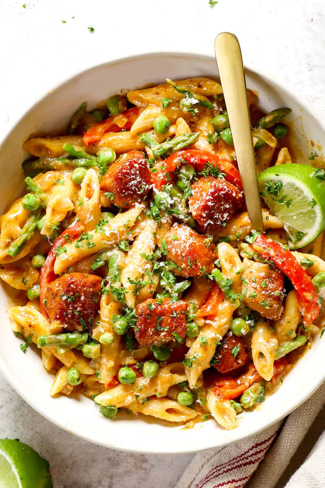

# Spicy Chicken Chipotle Pasta

> Household educational study notes for recipe-writing critique. Adapted summary with attribution — always check the original page for the authoritative version.

**Source:** [Original recipe](https://carlsbadcravings.com/spicy-chicken-chipotle-pasta/)

*Illustration photo for study — credit linked source / traditional teaching sketch.*

## Key data

| | |
|---|---|
| **Portions** | 6 |
| **Calories** | Not listed on source |
| **Prep** | 25 min |
| **Cook** | 25 min |
| **Total** | 50 min |

## Ingredients

- 1 ½ teaspoon chipotle chili pepper, chili powder
- 1 tsp EACH ground cumin, smoked paprika, onion powder, garlic powder, salt
- 1/4 teaspoon pepper
- 2 medium chicken breasts, (pounded to tenderize, then chopped into bite size pieces)
- 2 tablespoons olive oil
- 2 tablespoons honey
- 1 tablespoon lime juice
- 1 cup asparagus, 1-inch chop
- 1 pound penne
- 2 tablespoons olive oil
- 2 tablespoons unsalted butter
- 1 yellow onion, (chopped)
- 2 bell peppers (red, yellow and/or orange) (thinly sliced)
- 4-6 cloves garlic, (minced)
- 1/4 cup flour
- 2 1/2 cups low sodium chicken broth
- 1 ½ cups half and half ((or milk whisked with 1 TBS cornstarch, or evaporated milk mixed with 2 tsps. cornstarch))
- 1 ½ teaspoons chicken bouillon ((granulated, crushed cubes or base))
- 1/2 teaspoon dried oregano
- 1 cup freshly shredded sharp cheddar
- 1/2 cup freshly grated Parmesan
- 1 tablespoon lime juice
- 1/2 cup frozen petite peas ((don’t thaw))
- freshly grated Parmesan cheese
- fresh parsley or cilantro
- lime juice

## Method

1. Pasta water:  Start the water boiling for your pasta in a large pot, meanwhile season the chicken and prep the veggies.
2. Spice Mix: In a small bowl, whisk the spices together. Remove 1 1/2 tablespoons to use on the chicken (the rest is for the pasta sauce).
3. Season chicken: While the chopped chicken is still on the cutting board, pat dry with paper towels, then toss with the 1 1/2 tablespoon spice mix; set aside.
4. Cook asparagus:  Prepare a large bowl of ice water and place a colander inside (skip colander if you have a pasta pot with drain insert).  Season the boiling pasta water generously with salt.  Add the asparagus and boil for 2-3 minutes or until tender crisp.  Use a fine mesh sieve (or drain insert) to transfer the asparagus to the colander in the ice bath to prevent it from continuing to cook.
5. Cook pasta: Cook pasta in the boiling water just until al dente. Reserve ½ cup pasta water before draining. Drain, rinse and toss pasta with a drizzle of olive oil; set aside.
6. Cook chicken: Heat 2 tablespoons olive oil in an enameled cast iron braiser or Dutch oven over medium-high heat. Once smoking, add chicken in a single layer. Sear chicken for 2-3 minutes, then flip over. Continue to cook for an additional 2-3 minutes, or just until cooked through.  Stir in 2 tablespoon honey and 1 tablespoon lime juice, until evenly coated.   Transfer to a plate including all of the yummy glaze (use a spatula to get it all).  Wipe the pan clean (so the residual honey doesn’t burn).
7. Sauté onions and peppers:  To the now empty pan, melt 2 tablespoons butter in 2 tablespoons olive oil over medium-high heat.  Add onions and sauté for 4 minutes.  Add bell peppers and remaining spice mix and cook for 2 minutes. Add garlic, and sauté for 30 seconds.
8. Make sauce: Sprinkle in the flour and cook for 1 additional minute. Reduce heat to low, then slowly whisk in the chicken broth, followed by the half and half. Stir in the chicken bouillon and oregano. Increase heat to medium-high and bring the sauce to a simmer until thickened, stirring often.
9. Add cheeses: Reduce heat to low. Working in batches, stir in the cheddar until melted, followed by Parmesan cheese until melted. You may need to cook for 1-2 minutes on low for the cheeses to completely melt.
10. Combine and season: Stir in the lime juice, chicken, asparagus, and peas, followed by the pasta.  Season with salt, pepper and/or chipotle chili pepper to taste.  If you would like to thin the sauce (optional), add some reserved pasta water a little at a time.   Garnish with freshly grated Parmesan cheese, fresh parsley or cilantro and lime juice (optional).

---

*Educational / critique use for MealPlan household. Do not republish as your own recipe.*
