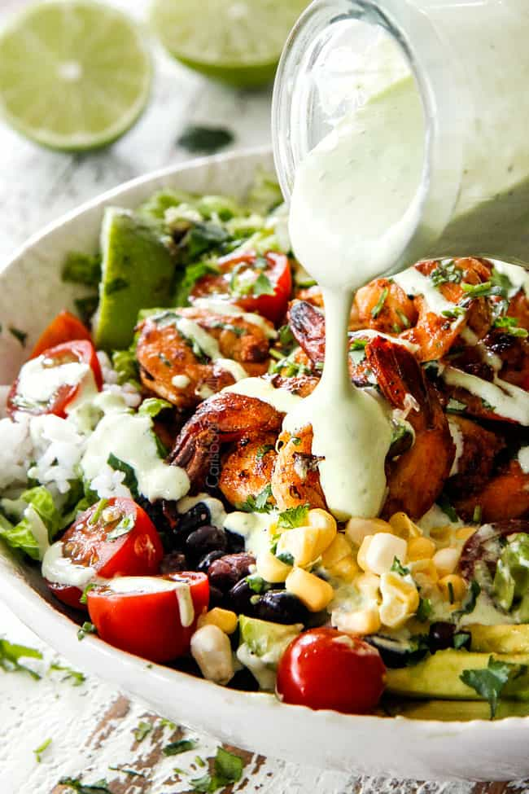

# Creamy Lime Cilantro Dressing

> Household educational study notes for recipe-writing critique. Adapted summary with attribution — always check the original page for the authoritative version.

**Source:** [Original recipe](https://carlsbadcravings.com/cilantro-lime-dressing/)

**Household changes:** A dressing, not a dinner. Kept in the book so it can be planned or shopped later.

*Illustration photo for study — credit linked source / traditional teaching sketch.*

## Key data

| | |
|---|---|
| **Portions** | 2 |
| **Calories** | Not listed on source |
| **Prep** | 5 min |
| **Total** | 5 min |

## Ingredients

- 1/3 cup packed cilantro
- 2 tomatillos (husks removed and roughly chopped)
- 1 jalapeno (deveined, seeded, roughly chopped)
- 2 garlic cloves (peeled)
- 1 cup real mayonnaise
- 1 cup sour cream (may sub Greek yogurt)
- 1 1/2 teaspoons lime juice (use less if using Greek yogurt)
- 2 tablespoons ranch seasoning mix ((1 oz. packet) - see DIY NOTES)
- 1/4 teaspoon smoked paprika (optional)
- Milk as needed

## Method

1. Add all of the ingredients to a blender puree until smooth, scraping sides down as needed. Add milk, a tablespoon at a time to reach desired consistency.
2. Chill before serving (a must!).  Dressing will thicken in the refrigerator so you may need to whisk in some milk before serving. This Cilantro Lime Dressing stores fabulously well for about 5-7 days, but honestly, it never lasts that long at our house!

---

*Educational / critique use for MealPlan household. Do not republish as your own recipe.*
