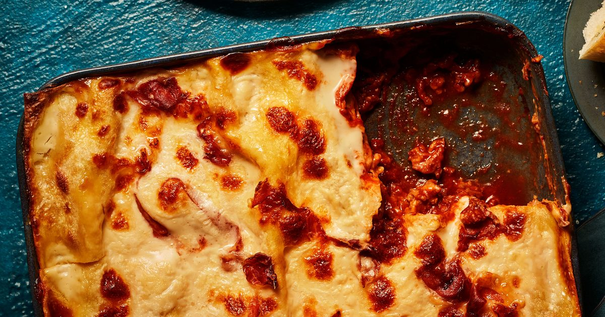

# Classic lasagne

**Source:** [BBC Good Food](https://www.bbcgoodfood.com/recipes/classic-lasagne-0)

## Key data

| | |
|---|---|
| **Portions** | 6 |
| **Calories** | 580 kcal/portion |
| **Prep** | 20 min |
| **Cook** | 100 min |
| **Total** | ~120 min (shop-bought white sauce) |

## Ingredients

- 2 tbsp olive oil
- 750 g lean beef mince
- 90 g prosciutto
- 800 g passata
- 200 ml hot beef stock
- nutmeg, to taste
- salt and black pepper, to taste
- 300 g fresh lasagne sheets
- 650 ml white sauce (shop-bought or homemade)
- 125 g mozzarella

## Method

1. Heat oil and brown the mince in two batches (~10 min).
2. Chop 4 slices of prosciutto into the meat.
3. Add passata, stock, nutmeg; season.
4. Simmer 30 min until rich.
5. Heat oven to 180C/160C fan/gas 4; oil a 30×20cm dish.
6. Layer meat, pasta, white sauce (~130 ml); repeat to three pasta layers; finish with remaining white sauce.
7. Top with mozzarella and remaining prosciutto.
8. Bake 45 min until bubbling; rest 10–15 min.
