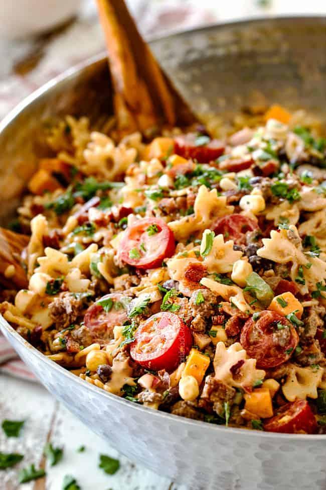

# Cowboy Pasta Salad with the BEST Dressing!

> Household educational study notes for recipe-writing critique. Adapted summary with attribution — always check the original page for the authoritative version.

**Source:** [Original recipe](https://carlsbadcravings.com/cowboy-pasta-salad/)

**Household changes:** A pasta salad, not a hot dinner.

*Illustration photo for study — credit linked source / traditional teaching sketch.*

## Key data

| | |
|---|---|
| **Portions** | 10 |
| **Calories** | Not listed on source |
| **Prep** | 15 min |
| **Cook** | 10 min |
| **Total** | 25 min |

## Ingredients

- 1 pound mini farfalle or other small pasta such as rigatoni or shells
- 1 pound lean ground beef or turkey (see note)
- 1 4 oz. can mild diced green chiles
- 1 tsp EACH chili powder, ground cumin
- 3/4 tsp EACH garlic powder, onion powder, salt ((omit salt if using ground turkey and bouillon) )
- 4-6 tablespoons diced canned/pickled jalapeno peppers ((from 4 oz. can))
- 1 green bell pepper (chopped)
- 1 15 oz. can black beans (rinsed and drained)
- corn from 1 ear sweet corn
- 1 pint cherry tomatoes (halved)
- 1 cup cubed sharp cheddar cheese
- 1/4 small red onion (chopped)
- 1/4 cup chopped cilantro
- 1/2 pound thick center cut bacon (cooked and chopped)
- 1/3 cup ketchup
- 1/3 cup mayonnaise
- 1/3 cup sour cream (may sub plain Greek yogurt)
- 1/4 cup salsa (medium if you like a kick)
- 1 1/2 tablespoons brown sugar
- 1 tablespoon Worcestershire sauce
- 1 tablespoon yellow mustard
- 1 tablespoon apple cider vinegar, plus more to taste
- 1/4 tsp EACH smoked paprika, salt, pepper
- Hot sauce/Tabasco to taste

## Method

1. Whisk together all of the Dressing ingredients in a medium bowl.  Add plenty of Tabasco to taste.  Set aside.
2. Cook pasta just until al dente according to package directions.  Rinse with cold water and drain.  Add to a large serving bowl and toss with half of the dressing.
3. Brown meat in a large skillet over medium heat.  Drain off excess grease. Stir in green chiles and all spices.  Set aside to cool while you chop your veggies.
4. Add beef and all remaining salad ingredients to pasta except bacon.
5. If serving immediately,  add bacon and stir in desired amount of dressing.  If not serving immediately, hold bacon and dressing and add when ready to serve.  Add hot sauce for spicier, apple cider vinegar for tangier, brown sugar for less tangy if desired.
6. Cowboy Pasta Salad can be served slightly chilled, at room temperature, or heated through.  Leftovers are equally delicious heated in the microwave.

---

*Educational / critique use for MealPlan household. Do not republish as your own recipe.*
