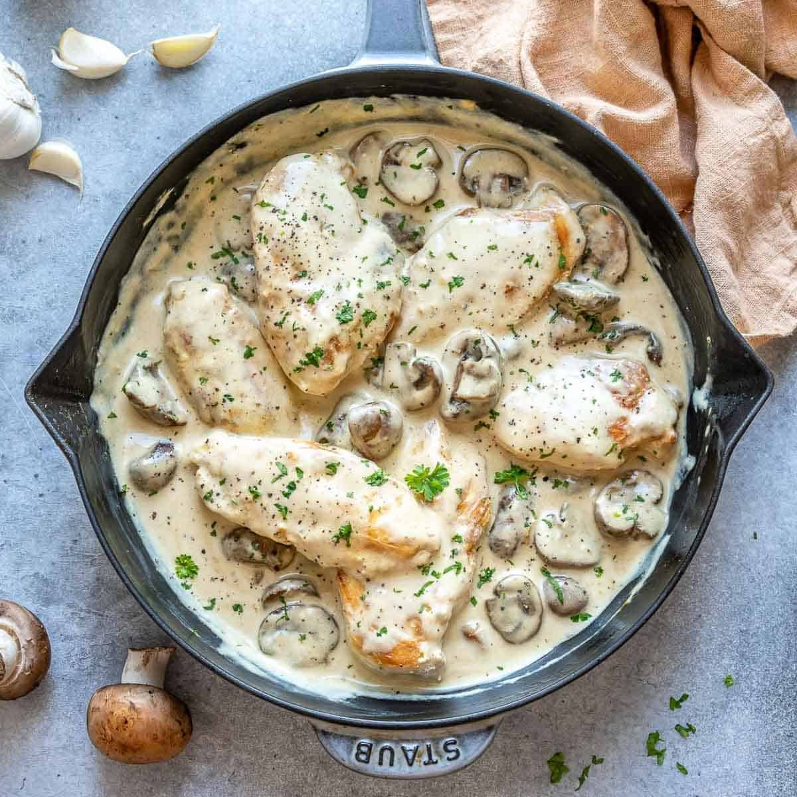

# Easy Creamy Mushroom Chicken (No Heavy Cream)

> Household educational study notes for recipe-writing critique. Adapted summary with attribution — always check the original page for the authoritative version.

**Source:** [Rena Awada / Healthy Fitness Meals](https://healthyfitnessmeals.com/creamy-mushroom-chicken/)

*Illustration photo for study — credit linked source / traditional teaching sketch.*

## Key data

| | |
|---|---|
| **Portions** | 6 |
| **Calories** | 224 kcal |
| **Prep** | 10 min |
| **Cook** | 20 min |
| **Total** | 30 min |

## Ingredients

- 2 tablespoons olive oil, divided
- 1.5 pounds boneless skinless chicken breasts
- 3 garlic cloves, crushed
- 8 ounces button mushrooms, halved or sliced
- 1 1/4 cup chicken broth
- 1/2 teaspoon cornstarch
- 1/2 teaspoon salt
- 1/4 teaspoon pepper
- 4 ounces light cream cheese, softened
- 1 tablespoon fresh chopped parsley

## Method

1. Heat 1 tbsp oil; sear chicken until golden, about 5 minutes per side. Remove and keep warm.
2. Heat remaining oil; brown mushrooms, then garlic until fragrant.
3. Whisk cornstarch with 2 tbsp water. Add broth and slurry; season; bring to a bubble.
4. Whisk in softened cream cheese until smooth and thick.
5. Return chicken; spoon sauce over; garnish with parsley.

---

*Educational / critique use for MealPlan household. Do not republish as your own recipe.*
