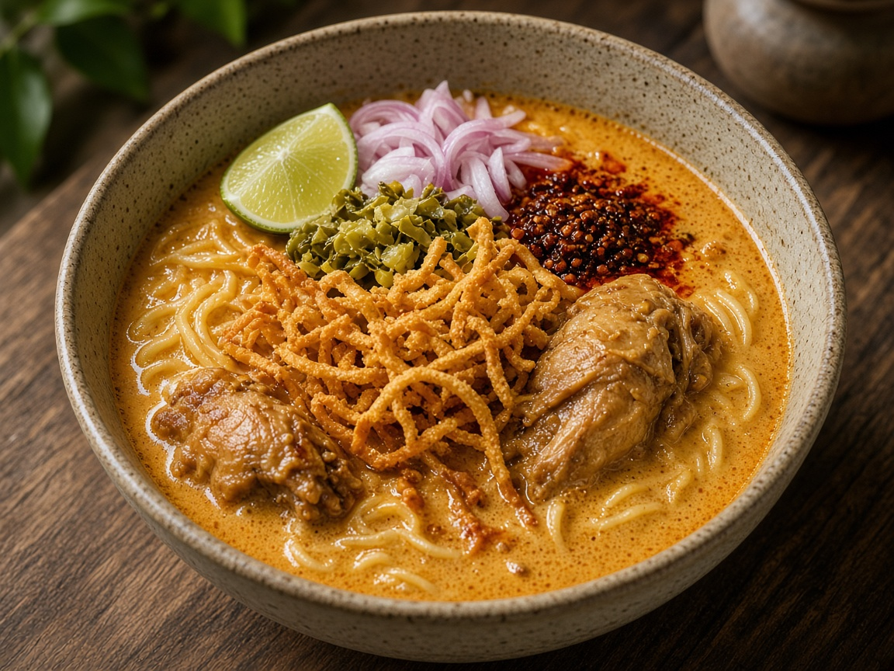

# Khao Soi (Northern Thai curry noodle soup)

> Household educational study notes for recipe-writing critique. Adapted summary with attribution — always check the original page for the authoritative version.

**Source:** Household placeholder (no published link yet)

**Notes:** You wrote ‘khao san’. Stored as khao soi — northern Thai coconut curry noodle soup. No source link yet.

*Illustration photo for study — credit linked source / traditional teaching sketch.*

## Key data

| | |
|---|---|
| **Portions** | 4 |
| **Calories** | Not listed |

## Ingredients

- Egg noodles (boiled + some fried crisp for topping)
- 500 g chicken pieces
- Khao soi / yellow curry paste
- Coconut milk
- Chicken stock
- Fish sauce, sugar, curry powder (optional)
- Pickled mustard greens, shallot, lime, chilli oil, coriander — toppings

## Method

1. Fry paste in coconut cream; add chicken and brown lightly.
2. Add coconut milk and stock; simmer until chicken is tender and sauce is rich.
3. Season; ladle over boiled noodles.
4. Top with crisp noodles, pickles, shallot, lime, chilli oil.
5. Critique note: contrast soft noodles + crunchy topping is the dish’s teaching point.

---

*Educational / critique use for MealPlan household. Do not republish as your own recipe.*
