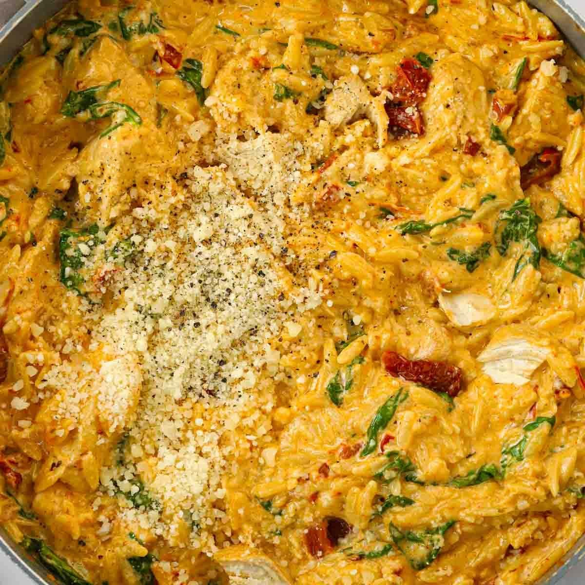

# Marry Me Chicken Orzo

> Household educational study notes for recipe-writing critique. Adapted summary with attribution — always check the original page for the authoritative version.

**Source:** [Taming Twins](https://www.tamingtwins.com/marry-me-chicken-orzo/)

*Illustration photo for study — credit linked source / traditional teaching sketch.*

## Key data

| | |
|---|---|
| **Portions** | 4 |
| **Calories** | 790 kcal |
| **Prep** | 5 min |
| **Cook** | 25 min |
| **Total** | 30 min |

## Ingredients

- 650 g skinless boneless chicken breast, chopped
- 1 tbsp olive oil (or oil from sun-dried tomato jar)
- 3 garlic cloves, crushed
- 170 g sun-dried tomatoes in oil, drained
- 1 tsp oregano
- 2 tsp paprika
- 250 g orzo
- 650 ml hot chicken stock
- 150 ml double / heavy cream
- 50 g Parmesan, grated
- 120 g spinach
- Freshly ground black pepper

## Method

1. Fry chicken in oil over medium heat about 5 minutes until starting to colour.
2. Add garlic, sun-dried tomatoes, oregano and paprika; stir 3–5 minutes.
3. Add orzo, stock and pepper; cover and cook about 10 minutes, stirring now and then.
4. On lowest heat, stir in spinach and cream 1–3 minutes until wilted and hot; check chicken is cooked.
5. Off heat, stir in Parmesan.

---

*Educational / critique use for MealPlan household. Do not republish as your own recipe.*
