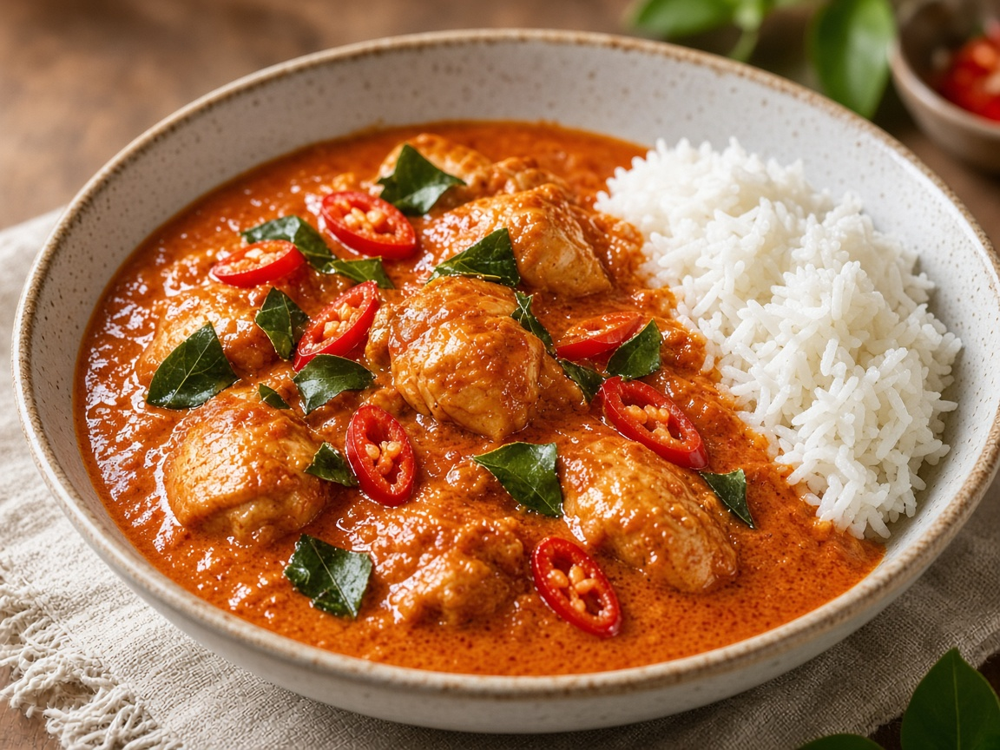

# Patang Curry (likely Penang / Panang)

> Household educational study notes for recipe-writing critique. Adapted summary with attribution — always check the original page for the authoritative version.

**Source:** Household placeholder (no published link yet)

**Notes:** Stored from ‘Patang’. Likely Penang/Panang curry. No source link yet — teaching sketch of classic Panang profile.

*Illustration photo for study — credit linked source / traditional teaching sketch.*

## Key data

| | |
|---|---|
| **Portions** | 4 |
| **Calories** | Not listed |

## Ingredients

- 500 g chicken thighs, sliced (or preferred protein)
- 2–3 tbsp Panang curry paste
- 1 can (400 ml) coconut milk
- 1–2 tbsp fish sauce
- 1 tsp palm or brown sugar
- Makrut lime leaves, torn
- Thai basil (optional)
- Red chilli, sliced, to garnish
- Jasmine rice, to serve

## Method

1. Fry curry paste in a splash of thick coconut cream until fragrant.
2. Add chicken; coat and cook until sealed.
3. Pour remaining coconut milk; simmer until chicken is cooked and sauce thickens.
4. Season with fish sauce and sugar; finish with lime leaves and basil.
5. Serve with rice. Critique note: Panang should be thicker/richer than a thin red curry.

---

*Educational / critique use for MealPlan household. Do not republish as your own recipe.*
