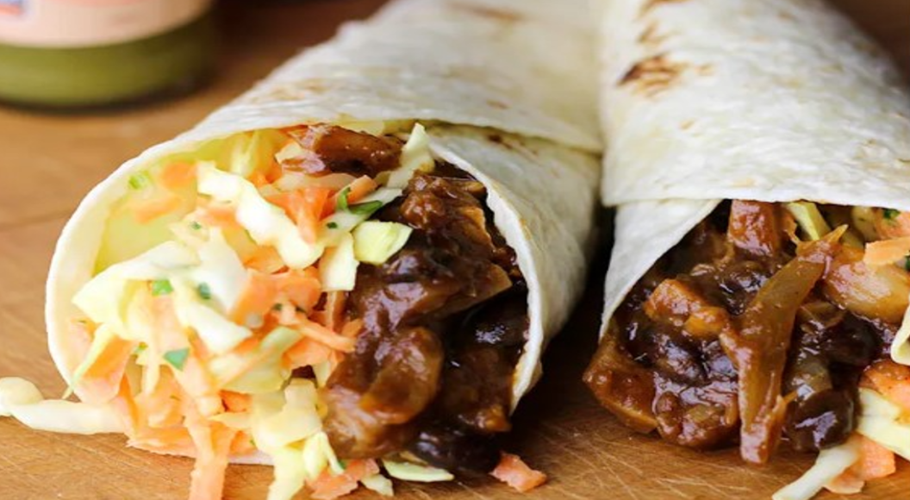

# Pulled Pork Wraps with Country Coleslaw

> Household educational study notes for recipe-writing critique. Adapted summary with attribution — always check the original page for the authoritative version.

**Source:** [AgOnline / Inspired by Roger](https://www.agonline.co.nz/recipes/pulled-pork-wraps-country-coleslaw-inspired-roger)

*Illustration photo for study — credit linked source / traditional teaching sketch.*

## Key data

| | |
|---|---|
| **Portions** | 6–8 wraps |
| **Calories** | Not listed on source |
| **Cook** | Slow cooker low ~8 hours (typical) |
| **Total** | ~3+ hours active window / overnight cook |

## Ingredients

- Pulled pork: 2.3–2.8 kg pork shoulder
- 1 onion, halved
- 1/4 cup brown sugar
- 1 Tbsp salt
- 1 Tbsp black pepper
- 1 Tbsp cumin
- 1 1/2 tsp smoked paprika
- 3/4 tsp cayenne pepper
- 1 cup chicken stock
- 3/4 cup ketchup
- 1/2 cup dark molasses
- 2 Tbsp Worcestershire
- 1 Tbsp mustard
- Wraps: 6–8 flatbreads/wraps
- 2 cups crispy onions
- 1 1/2 cups coleslaw

## Method

1. Mix dry rub: brown sugar, salt, pepper, cumin, paprika, cayenne.
2. Mix wet sauce: stock, ketchup, molasses, Worcestershire, mustard.
3. Put pork and halved onion in slow cooker; add dry spices then wet mixture.
4. Cook on low until shreddable (source notes long low cook).
5. Shred pork; assemble wraps with coleslaw and crispy onions.

---

*Educational / critique use for MealPlan household. Do not republish as your own recipe.*
