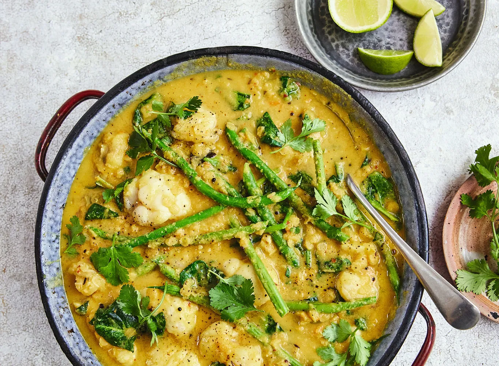

# South Indian chicken and lentil curry

> Household educational study notes for recipe-writing critique. Adapted summary with attribution — always check the original page for the authoritative version.

**Source:** [Dr Rupy Aujla](https://www.thedoctorskitchen.com/recipes/south-indian-style-monkfish-and-lentil-curry)

**Household changes:** Use chicken instead of monkfish.

*Illustration photo for study — credit linked source / traditional teaching sketch.*

## Key data

| | |
|---|---|
| **Portions** | 4 |
| **Calories** | 621 kcal |
| **Prep** | 20 min |
| **Cook** | 35 min |

## Ingredients

- 2 tsp red chilli flakes
- 2 tbsp desiccated coconut
- 100 ml boiling water
- 100 g red onion, chopped
- 300 g tomatoes, chopped
- 6 garlic cloves, peeled
- 25 g ginger
- salt, to taste
- black pepper, to taste
- 2 tbsp coconut oil
- 1 star anise
- 2 tsp cumin seeds
- 2 tsp black mustard seeds
- 1 tsp turmeric powder
- 12 curry leaves (optional)
- 150 g dried red lentils, washed
- 1 tin coconut milk
- 300 ml vegetable stock
- 600 g chicken, cut into pieces
- 300 g green beans, halved
- 150 g baby spinach, roughly chopped
- 30 g coriander, roughly chopped
- 2 limes, cut into wedges

## Method

1. Gather and prepare your ingredients.
2. For the curry paste, soak the chilli flakes and coconut in the boiling water for 10 minutes. Blend with onion, tomatoes, garlic, ginger, salt and pepper until smooth.
3. Heat coconut oil in a heavy pan over medium-low heat. Fry star anise, cumin seeds, mustard seeds, turmeric and curry leaves 1–2 minutes. Add the paste and fry about 5 minutes until thick and fragrant.
4. Add lentils, coconut milk and stock. Simmer gently about 20 minutes until lentils are soft.
5. HOUSEHOLD: Add chicken (instead of monkfish), green beans and spinach; cook until chicken is done and beans are tender (about 8–12 minutes).
6. Serve with coriander and lime wedges.

---

*Educational / critique use for MealPlan household. Do not republish as your own recipe.*
