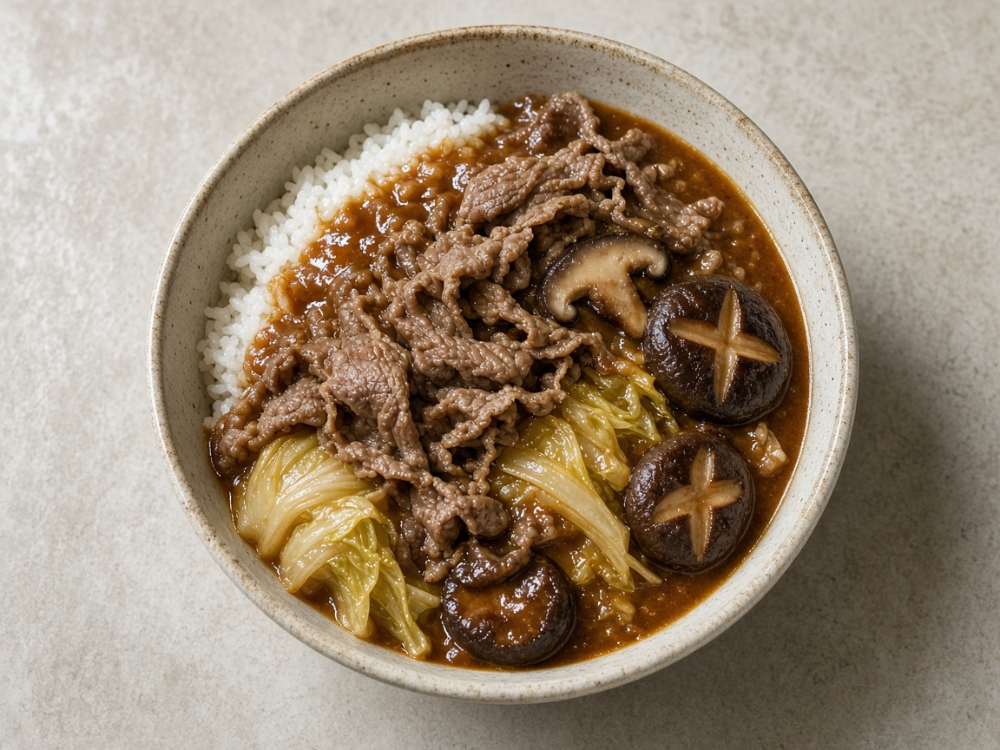

# Sukiyaki Curry

> Household educational study notes for recipe-writing critique. Adapted summary with attribution — always check the original page for the authoritative version.

**Source:** Household placeholder (no published link yet)

**Notes:** Name-only household dish so far. No source link. Protein assumed beef until confirmed. Teaching sketch of sukiyaki flavours in a curry-style sauce.

*Illustration photo for study — credit linked source / traditional teaching sketch.*

## Key data

| | |
|---|---|
| **Portions** | 4 |
| **Calories** | Not listed |

## Ingredients

- 400–500 g thinly sliced beef (or preferred protein)
- 1 onion, sliced
- Handful shiitake or button mushrooms
- Napa cabbage or greens, roughly cut
- 1 block firm tofu, cubed (optional)
- 2–3 tbsp soy sauce
- 2 tbsp mirin
- 1–2 tbsp sugar
- 1 cup dashi or light stock
- 1–2 tbsp Japanese curry roux or mild curry powder + thickener
- Cooked rice, to serve
- Optional: beaten egg stirred in at the end (sukiyaki-style)

## Method

1. Brown beef quickly; set aside.
2. Sweat onion and mushrooms; add cabbage/tofu.
3. Add soy, mirin, sugar, and stock; simmer until vegetables soften.
4. Stir in curry roux/powder to thicken into a glossy stew.
5. Return beef briefly; serve over rice. Critique note: balance sweet-salty vs curry heat.

---

*Educational / critique use for MealPlan household. Do not republish as your own recipe.*
