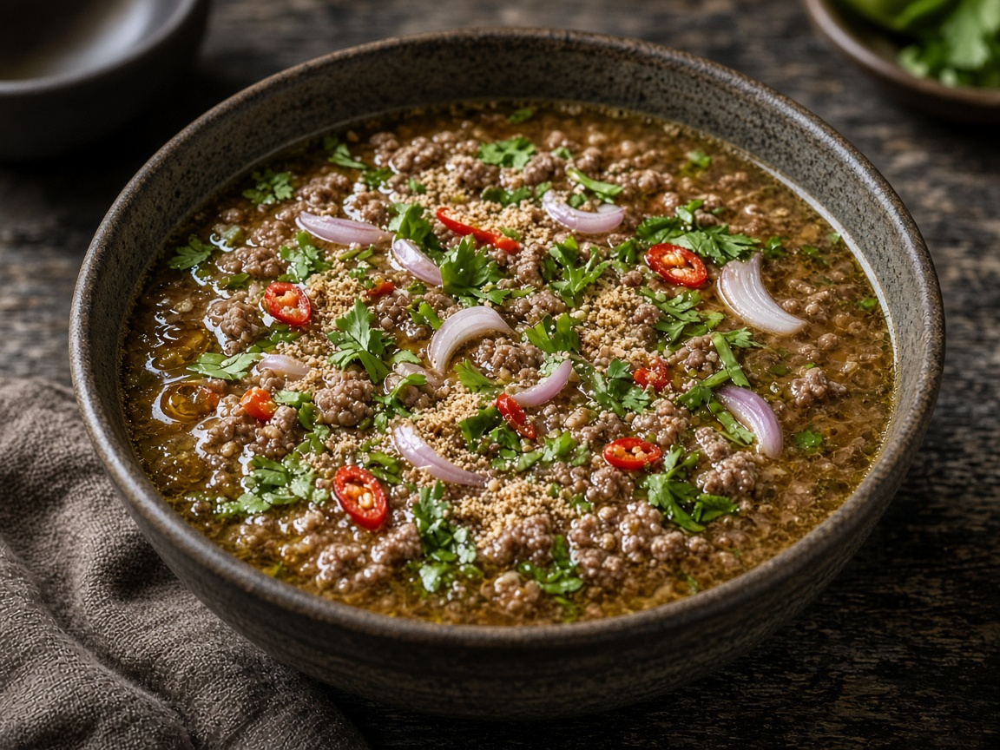

# Tom Saab (ground beef soup)

> Household educational study notes for recipe-writing critique. Adapted summary with attribution — always check the original page for the authoritative version.

**Source:** Household placeholder (no published link yet)

**Notes:** Ground beef soup. Isaan tom saab is typically hot, sour, herbaceous with toasted rice powder.

*Illustration photo for study — credit linked source / traditional teaching sketch.*

## Key data

| | |
|---|---|
| **Portions** | 4 |
| **Calories** | Not listed |

## Ingredients

- 400 g ground beef
- Stock or water
- Lemongrass, galangal, lime leaves, shallot
- Fish sauce, lime juice, chilli
- Toasted rice powder (khao khua)
- Shallots, coriander, spring onion, sawtooth coriander if available
- Optional offal for traditional versions

## Method

1. Simmer aromatics in stock.
2. Cook ground beef in the broth; skim if needed.
3. Season boldly hot-sour-salty; thicken mouthfeel with toasted rice powder.
4. Heap with fresh herbs and shallot. Critique note: toasted rice powder is the signature texture.

---

*Educational / critique use for MealPlan household. Do not republish as your own recipe.*
