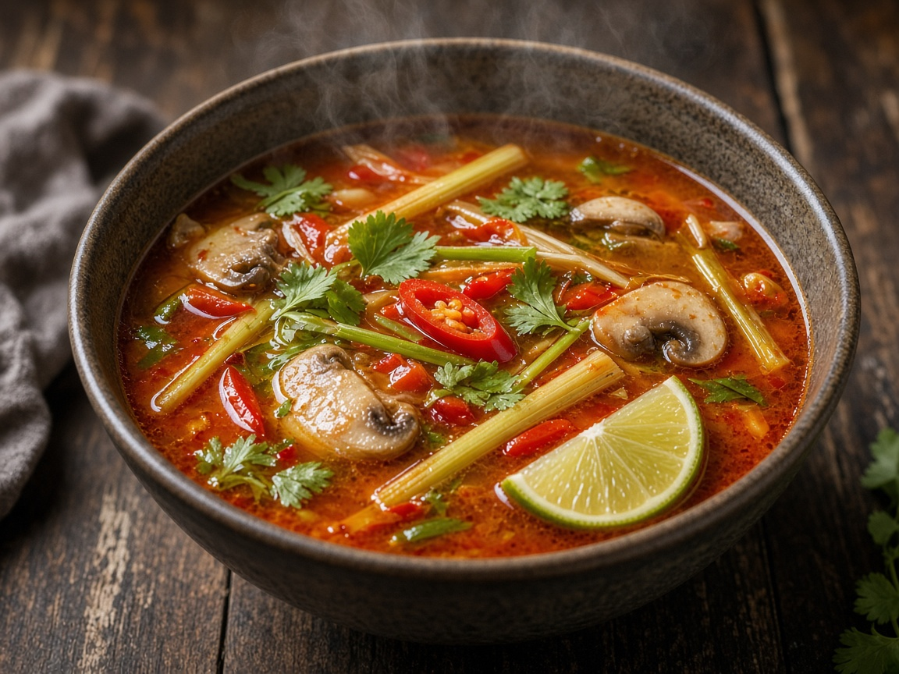

# Tom Yum

> Household educational study notes for recipe-writing critique. Adapted summary with attribution — always check the original page for the authoritative version.

**Source:** Household placeholder (no published link yet)

**Notes:** Name-only so far. Classic hot-sour Thai soup. Protein assumed poultry until confirmed.

*Illustration photo for study — credit linked source / traditional teaching sketch.*

## Key data

| | |
|---|---|
| **Portions** | 4 |
| **Calories** | Not listed (typically light broth) |

## Ingredients

- 1 L chicken or prawn stock / water + stock
- Lemongrass stalks, bruised
- Galangal slices
- Makrut lime leaves
- Thai chillies, bruised
- Mushrooms
- 300–400 g chicken or prawns
- 2–3 tbsp fish sauce
- Lime juice, to taste
- Optional: nam prik pao (roasted chilli paste) for tom yum nam khon richness
- Coriander, to finish

## Method

1. Simmer aromatics (lemongrass, galangal, lime leaves, chilli) in stock until fragrant.
2. Add mushrooms and protein; cook through.
3. Season hot-sour-salty with fish sauce and lime; add chilli paste if using creamy style.
4. Finish with coriander. Critique note: balance sour vs spicy; don’t boil lime juice long.

---

*Educational / critique use for MealPlan household. Do not republish as your own recipe.*
