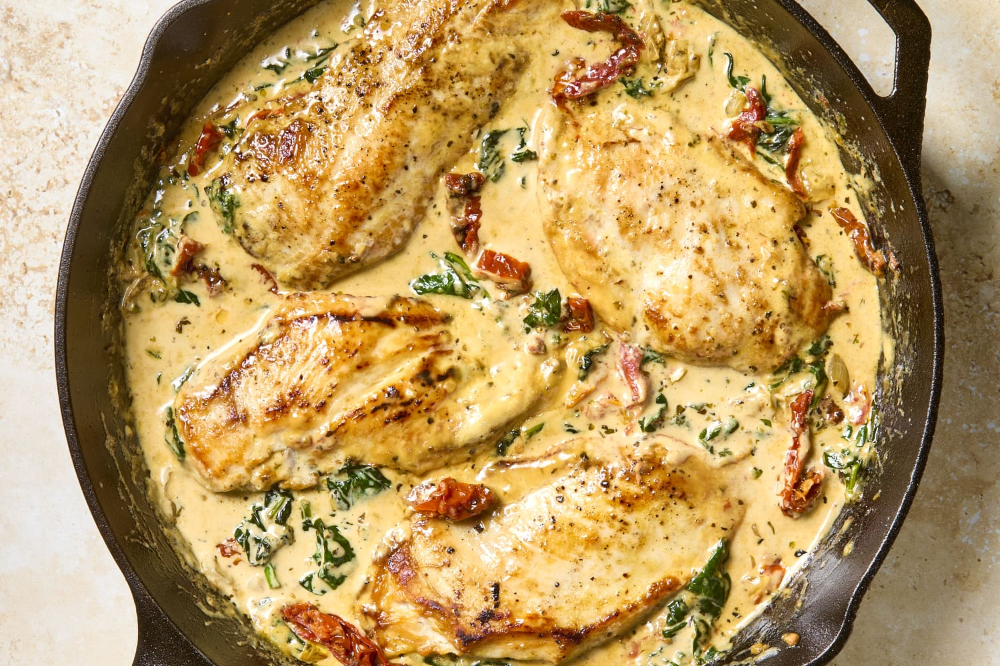

# Creamy Tuscan Chicken

> Household educational study notes for recipe-writing critique. Adapted summary with attribution — always check the original page for the authoritative version.

**Source:** [The Kitchn](https://www.thekitchn.com/tuscan-chicken-recipe-23624913)

**Household changes:** Added mushrooms. Doubled all the spices for extra flavour, so the sauce is very liquid.

*Illustration photo for study — credit linked source / traditional teaching sketch.*

## Key data

| | |
|---|---|
| **Portions** | 4 |
| **Calories** | 612 kcal |
| **Prep** | 15 min |
| **Cook** | 35 min |
| **Total** | 50 min |

## Ingredients

- 2 large boneless, skinless chicken breasts (1 1/2 to 2 pounds total)
- 1 1/2 teaspoons kosher salt, divided
- 1/2 teaspoon freshly ground black pepper
- 2 to 3 tablespoons olive oil, divided
- 1 small yellow onion, diced (2/3 cup)
- 3 cloves garlic, minced
- 1/2 cup drained oil-packed sun-dried tomatoes (2 1/2 ounces), thinly sliced
- 2 teaspoons dried Italian seasoning
- 5 ounces baby spinach (5 packed cups)
- 1 ounce Parmesan cheese (1/2 cup firmly packed freshly grated or 1/3 cup store-bought grated)
- 1 1/4 cups heavy cream
- HOUSEHOLD: mushrooms (amount to taste)
- HOUSEHOLD: double the Italian seasoning (and other spices you add)

## Method

1. Butterfly the chicken breasts horizontally, pat dry, and season with most of the salt and the pepper.
2. Sear in batches in hot olive oil until browned on both sides (chicken will finish in the sauce). Set aside.
3. Soften onion in the pan, then add garlic, sun-dried tomatoes, Italian seasoning (HOUSEHOLD: double spices), and mushrooms. Cook until fragrant; wilt spinach.
4. Stir in Parmesan, cream, and remaining salt. Simmer gently, scraping up browned bits.
5. Return chicken and juices; cook until chicken reaches 165°F / 74°C (about 4–7 minutes). Expect a looser sauce with doubled spices and mushrooms.

---

*Educational / critique use for MealPlan household. Do not republish as your own recipe.*
